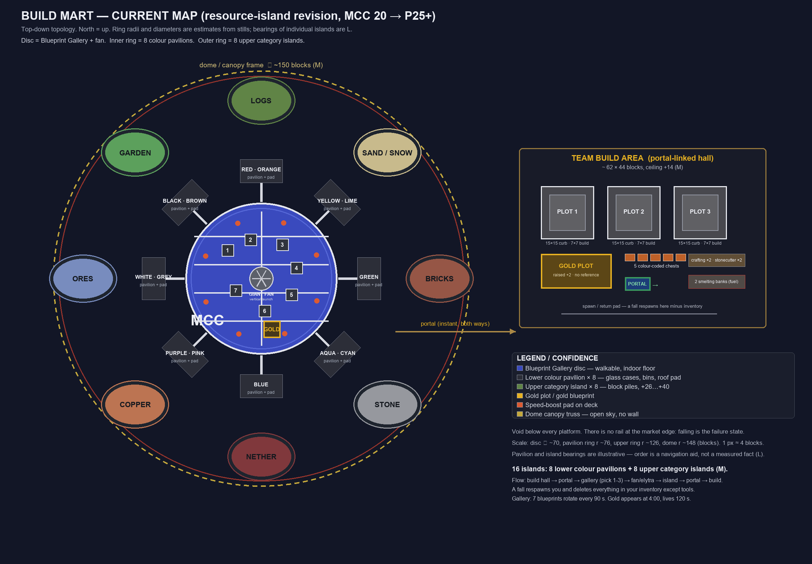
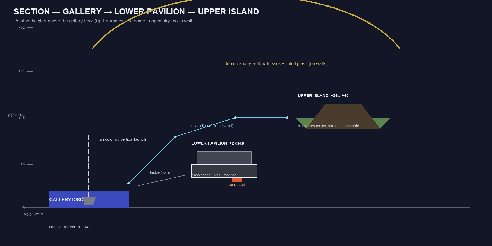

# Current map — plan and elevation

Rendered schematics (open the PNGs directly; they are research abstractions, not traces):

| file | what |
|---|---|
| `current_topdown.png` | whole mart + build area, north-up |
| `gallery_plan.png` | the 7+1 plinths on the disc |
| `build_area_plan.png` | one team's hall |
| `elevation.png` | section: disc → pavilion → upper island |



---

## Top-down, as a text plan

```
                          L O G S                  <- upper island, +26…+40
                     ╭───────────────╮
             GARDEN  │   (block      │  SAND / SNOW
                     │    piles)     │
                      ╰──────────────╯
        ╭─────╮            ╭────╮            ╭─────╮
        │BLACK│            │RED │            │YELL│
        │·BRN │───bridge───│·ORG│───bridge───│·LIM│     <- lower pavilions, +2
        ╰─────╯            ╰────╯            ╰─────╯
   ╭─────╮                ╭────────╮                ╭─────╮
   │WHITE│────────────────│  DISC  │────────────────│GREEN│
   │·GREY│   3-wide       │  ⌀ ~66 │                │     │
   ╰─────╯   no rail      │ fan ◉  │                ╰─────╯
        ╭─────╮           │ 1..7 +G│           ╭─────╮
        │PURP │───────────│  ▓▓▓▓  │───────────│AQUA │
        │·PINK│           ╰────────╯           │·CYAN│
        ╰─────╯                                ╰─────╯
                      ╭─────╮     ╭─────╮
                      │BLUE │     │STONE│
                      ╰─────╯     ╰─────╯
                          N E T H E R
                    (size/exact bearing: L)
```

Vertical stack at any bearing, from the disc outward:

```
y +60  ─ dome apex (yellow truss + tinted glass)
y +40  ─ upper island top
y +26  ─ upper island lip                [elytra target]
y +10  ─ pavilion sign / hanging island sign
y  +8  ─ pavilion roof launch pad
y  +2  ─ pavilion deck                   [walk + collect]
y   0  ─ gallery disc floor              [fan + plinths]
y  -∞  ─ void
```

---

## Elevation



Read it as three shelves:

1. **Gallery shelf (0).** A single walkable disc. Everything the player needs to *decide* is here. It is the only place with a solid, safe floor of any size.
2. **Pavilion shelf (+2 deck, +7 roof).** The colour showrooms. Reached by short bridges; left by roof pad back toward the disc. These are the "near shop" — the first place a new player will go.
3. **Island shelf (+26…+40).** The bulk materials. Reached only by fan + elytra, no bridge, no rail. These are the "far quarry".

The step between shelf 2 and 3 is the whole game: it is the only place where a mistake costs the inventory.

---

## Reading order for a builder

1. `frames/pack/00_map_central_island_aerial.jpg` — get the concentric idea.
2. `current_topdown.png` — get the proportions.
3. `frames/pack/16_colour_pavilion_glass_cases.jpg` — understand that a pavilion is a *room*.
4. `frames/pack/09_upper_islands_logs_sand.jpg` — understand that an island is a *chunk*, not a platform.
5. `frames/pack/04_build_area_overview.jpg` + `build_area_plan.png` — build the hall.
6. `gallery_plan.png` + `frames/pack/02_gallery_plinth_and_materials.jpg` — build the plinths last; they are the smallest objects and the easiest to get wrong.

## What the schematic deliberately does not claim

- **Bearings.** The ring order in the PNG is a navigation aid. The three sources do not agree on a canonical clockwise order and the aerial is oblique.
- **Counts of 8.** Eight pavilions and eight upper islands is the best reading of the aerial plus the nine-category block sheet minus the Sand/Snow swap. If a live POV shows 7 or 9, trust the POV.
- **The 9th gallery pad.** Nine plinth-sized pads are visible; only 7 are selectable plus Gold. One is likely a spare/rotation buffer. Do not build a 9th interactive plinth.
