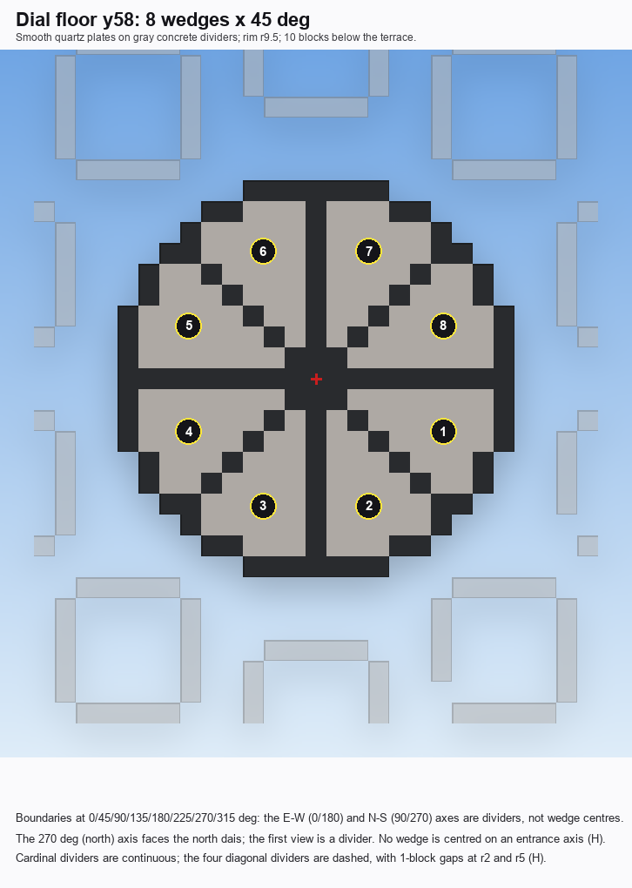
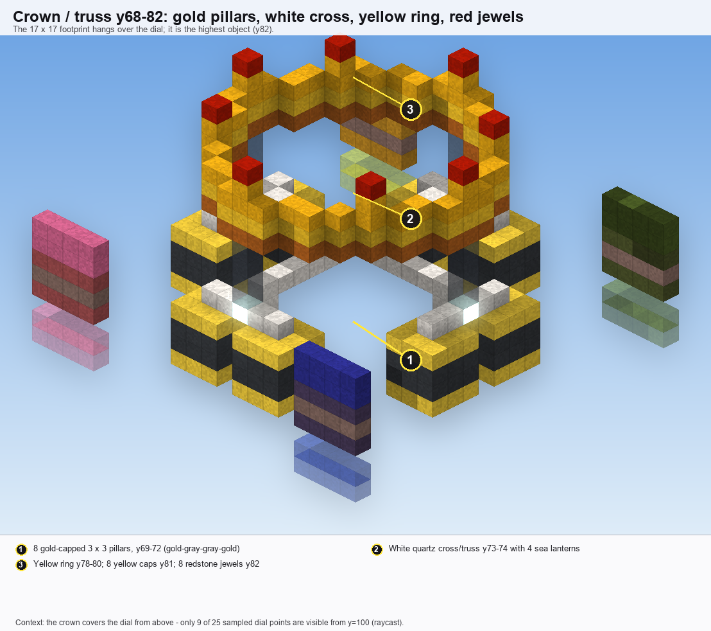
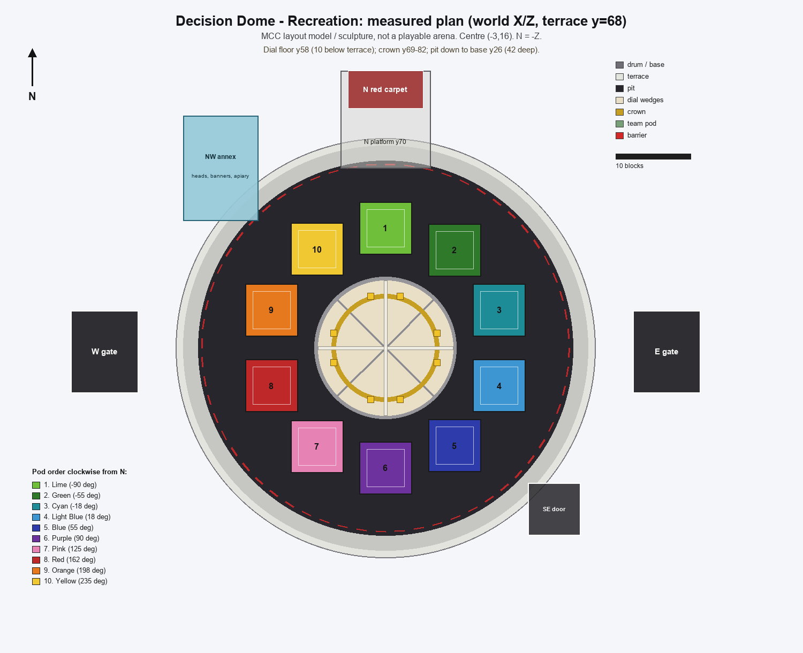
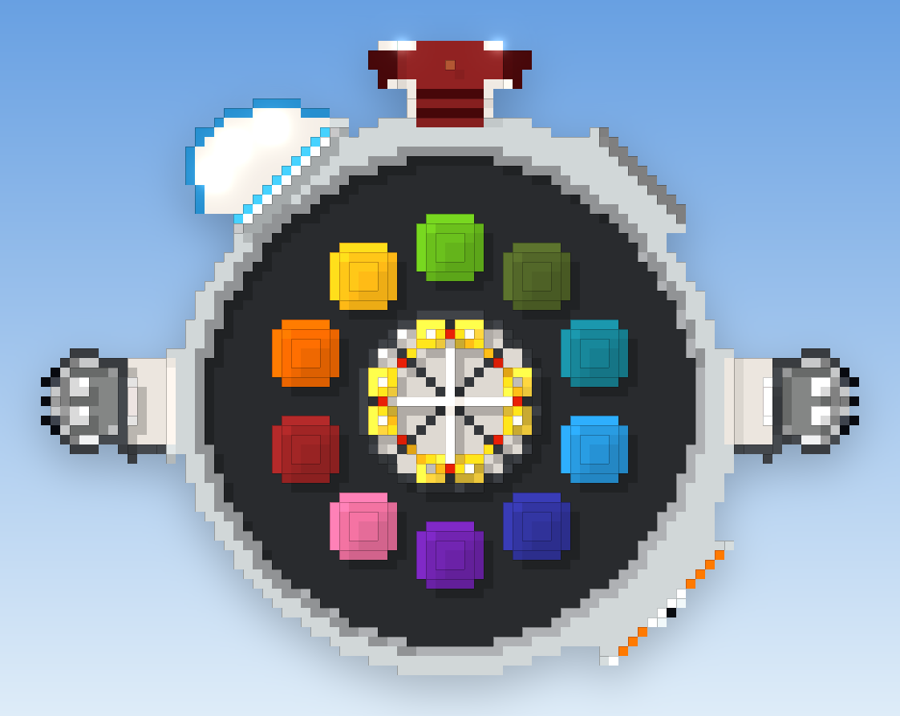
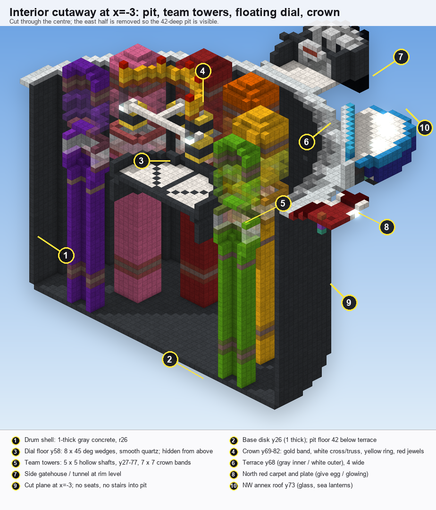
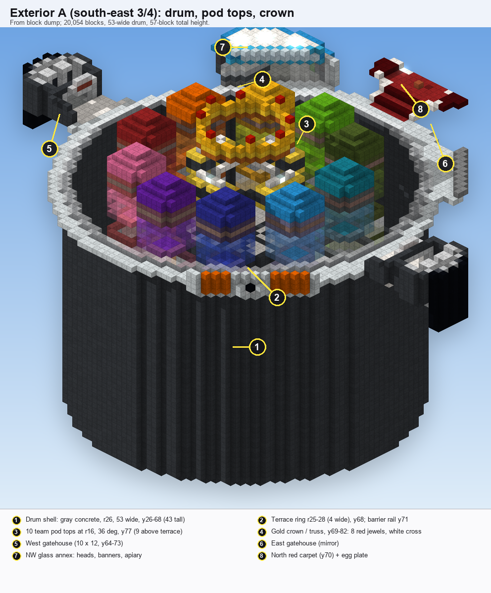
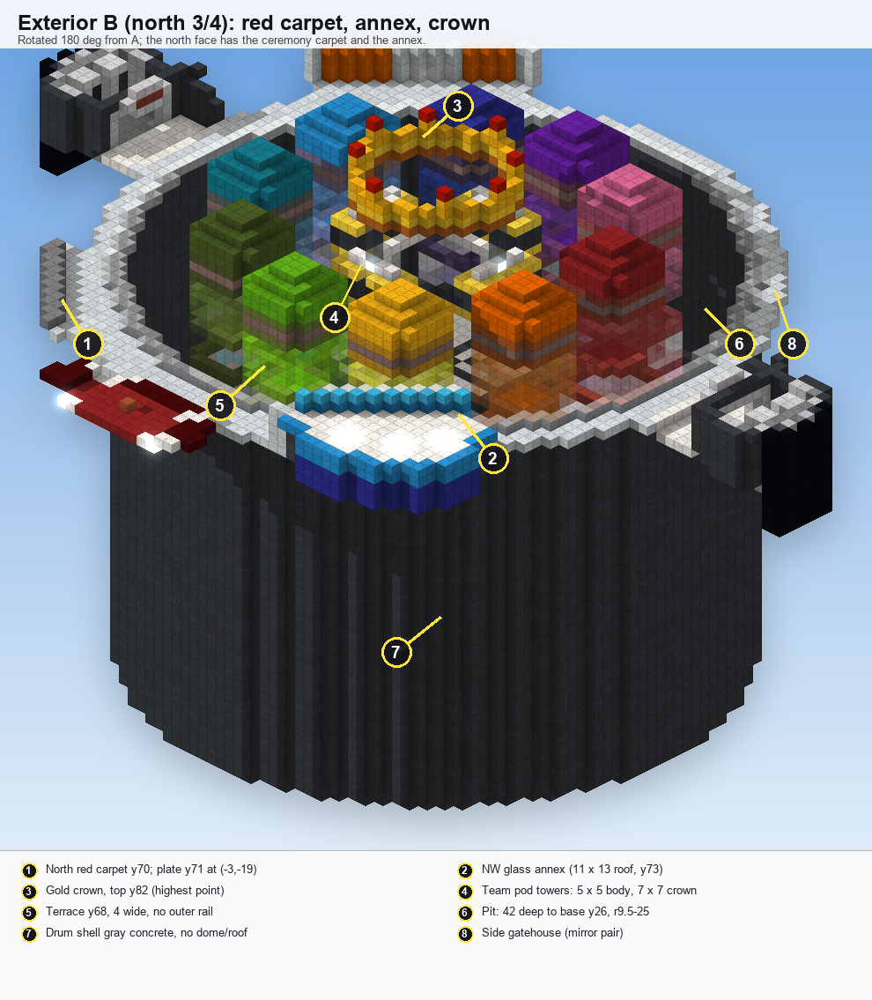
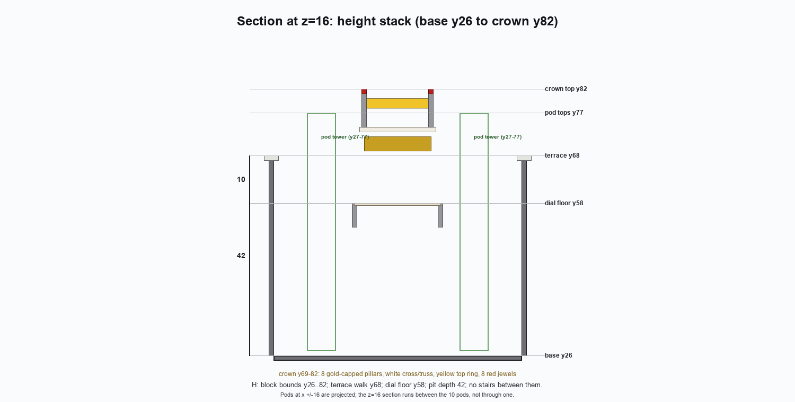

# Decision Dome — Recreation: forensic dossier

**World:** `Decision Dome - Recreation` (`mcc_decisiondome`)
**Source:** `C:\Users\LeonS\AppData\Local\Temp\opencode\mcc_maps\Decision_Dome\Decision Dome - Recreation`
**Version:** 1.17.1 (DataVersion 2730), single-player world last played 2021-10-09
**Size:** 20,054 non-air blocks, 85 base block types / 186 block states, 1,344 chunks, 4 region files (2 are 0 bytes), overworld only
**Evidence tags:** **H** = directly observed in the block/NBT/level scan or in a render I opened; **M** = inference from two or more observed facts; **L** = guess / unresolved.
**Status:** research complete; no game code, plugin code, build, paste, registry edit or server restart was made.

| Quick numbers | Value | Evidence |
|---|---:|---|
| Blocks | 20,054 | H |
| Envelope (x × y × z) | 85 × 57 × 66 blocks (x −45..39, y 26..82, z −21..44) | H |
| Drum | 53 wide (r26), 43 tall (y26–68), 1-block wall | H |
| Terrain | none; flat base disk at y26, floating in void | H |
| Terrace | y68, 4 wide (r25–28) | H |
| Pit | 42 deep (y68 → y26), annular r9.5–25 | H |
| Dial | y58, 8 × 45° zones, r9.0 quartz / r9.5 rim | H |
| Crown | 17 × 17, y69–82 (14 tall) | H |
| Pods | 10 at r16, 36° apart, 5×5 body / 7×7 crown, y27–77 | H |
| Seats | **0** | H |
| Stands / spectator tiers | **0** (4-wide standing ring only) | H |
| Stairs into the pit | **0** | H |
| Dome / roof | **none** | H |
| Command blocks | **2** (1 impulse, 1 chain) | H |
| Tile entities | **45** (24 banners, 17 skulls, 2 command blocks, 2 beehives) | H |
| Entities | **2 armor stands** | H |
| Signs / chests / item frames | 0 / 0 / 0 | H |
| Light sources | 18 sea lanterns | H |
| Copper blocks | **0** | H |
| Datapacks | **0 of the 12 zips active**; all 12 in `Disabled` (11 feature packs + `VanillaTweaks_c772085.zip`) + 1 unzipped bundle folder; source `Enabled=[vanilla, mod:forge, mod:worldedit]` | H |

---

## 0. Verdict in one page

**This is not a playable Decision Dome.** (H) It is a compact, highly stylised **model/sculpture of the dial hall**: a 53-wide gray drum with a 4-wide white rim, a 42-deep open pit, ten team-coloured towers rising from the pit to 9 blocks above the rim, a floating 8-zone dial 10 blocks below the rim, and a gold crown/truss 14 blocks above the rim. There is no glass dome, no roof, no stands, no seating, no pod rooms, no stair into the pit, no outer rail, no spawn on the build, and no vote/tally logic.

The strongest design idea is the **section**: ten full-height team colour shafts + a floating dial + a crown, read as a trophy/cake from outside and as a dramatic vertical well from a cutaway. The weakest is that the same towers **block the dial and the crown from the only walkable ring**, and the 8-zone dial is low-contrast, dashed and hidden under the crown. (H for geometry; M for the design judgement.)

**Corrections to the Wave-1 brief** (H):

1. **2 command blocks exist**, not 0: impulse at `(-3, 69, -19)` = `give @p egg`; chain at `(-3, 68, -19)` = `effect give @p minecraft:glowing 999999 255 true`. Both are in the overworld; both have `LastExecution=286717` and `SuccessCount=1`, so they have fired. A12's 2-command-block finding is confirmed.
2. **45 block entities exist**, not 0: 24 banners, 17 skulls, 2 command blocks, 2 beehives. All overworld.
3. **2 armor stands exist**: `(-19.5, 69, -7.5)`, one gold chestplate, one green leather chestplate.
4. **0 feature packs are active.** Source `level.dat` DataPacks `Enabled = [vanilla, mod:forge, mod:worldedit]`; all **12 zips** in `datapacks/` are in `Disabled` (11 feature packs + `VanillaTweaks_c772085.zip`), and `VanillaTweaks_d535816_UNZIP_ME` is an unzipped bundle folder, not a loaded pack. A12 is correct; this corrects the earlier active-pack count. The zip contents are generic QoL packs (AFK display, anti-enderman grief, cauldron concrete, coordinates HUD, custom nether portals, double shulker shells, durability ping, fast leaf decay, more mob heads, spectator conduit power, spectator night vision); **none drives the dome**.
5. DIM-1 and DIM1 contain only `data/` (raids/capabilities), **no region folder, no blocks, no command blocks**. The overworld scan is the complete scan.

**The five findings that matter for later integration:**

1. **The dial is buried.** (H) The dial floor is y58, 10 below the terrace; the crown at y69–82 covers it from above; the 10 towers at r16 (tops y77) stand between the terrace and the dial. A raycast from the 4-wide terrace sees **0–18 of 25** sampled dial points (mean 9.8); **5 of 24** standing positions see none; from the north red carpet **0/25** are visible; even from y100 only **9/25** are visible. No position sees the whole dial. This is a sculpture, not a vote surface.
2. **The pods are solid towers.** (H) Each is a 5×5 hollow shaft (3×3 void) with 3×3 caps at y64 and y77, 51 blocks tall (y27–77), flaring to 7×7 at y55–57 and y65–75. There is no door, no floor at terrace level, no room and **0 seats**. The ring has **no gap at 90°** — all 10 pods are present, including the south 90° pod (purple).
3. **The entrances are three arms plus a lounge and a service door.** (H) West and east gatehouses (10 × 12 × 10), a north stepped red-carpet dais (13 × 14 × 6), a NW glass-roofed lounge (11 × 15 × 12) and a decorative SE iron door. The west/east approaches, the north dais and the NW annex have 1-block steps; the pit has no stairs.
4. **The palette is concrete/terracotta/glass/quartz, with zero copper.** (H) Gray concrete is 44.6%; team concrete 26.0%; terracotta 9.4%; glass 9.2%; quartz 2.2%; gold 0.7%. There is no wood, stone brick, deepslate, basalt, calcite or copper. Lighting is 18 sea lanterns and fixed noon; the pit is unlit.
5. **The only interaction is a one-player egg/glow prop.** (H) The north plate gives the nearest player one egg and permanent Glowing; the NBT proves it has run. There is no team assignment, no gate, no score, no tally, no reset, and no dome logic in the packs. **Spawn:** the source spawn is `(0,4,0)`, 22 blocks below the base disk — it drops below the base and is unsafe; the live Multiverse spawn is `(0,76,0)` on lime concrete (the lime pod crown), which A12 verified as safe. *(A12 is authoritative on the live spawn; the source value is not a usable arrival point.)*

---

## 1. Method and evidence

- I read the world directly from `region/*.mca` (1.17.1 format), decoded every section palette and block-state long array, and aggregated 20,054 blocks. The full dumper is `_scratch/dump117.py`; the survey is `_scratch/survey.py`; the raw block list is `_scratch/blocks_raw.csv`. (H)
- The shared `tools/world_to_mcmdump.py` assumes the 1.18+ chunk layout (`sections` / `block_states`). This 1.17.1 world stores `Level.Sections` with `Palette` / `BlockStates`, so the shared tool would find no blocks. I did **not** edit the shared tool; I wrote a local 1.17-compatible dumper in `_scratch/` and report the mismatch as a tooling finding. (H)
- All renders use the shared `tools/render_preview.py` (read-only), with local `MCMDUMP` crops. The renderer draws stairs/slabs as full blocks and does not draw entities (banners/heads are blocks here; armor stands are entities). Height levels come from the block data, not the renderer's shading. (H / tool limitation)
- Raycasts use a 0.03-block step through the block grid; glass, panes, barriers, carpets and chains are treated as transparent. Eye height is 1.62 above the walk surface. 25 dial targets = 8 wedges × 3 radii (3, 6, 7.8) + centre. This is a geometric check, not an in-game camera test. (H with stated model)
- I opened every image cited in `REFERENCE_IMAGES.md`, including the official MCC stills used for context and the Nocturne Orrery previews. (H)

---

## 2. Exact anatomy

### 2.1 Centre, envelope and orientation

- Centre `(-3, 16)`; **north = −Z**, east = +X. The drum extents are x −29..23, z −10..42 (53 × 53). The full envelope adds the west/east gatehouses (x −45..39), the north dais (z −21) and the south rim (z 44): **85 × 66** footprint, **57** tall (y26–82). (H)
- The build floats: there is no terrain around it, only a 1-block-thick gray base disk at y26 (r25). (H)

### 2.2 Drum, terrace, pit

| Element | Measurement | Evidence |
|---|---|---|
| Drum shell | gray concrete, r26, 1 block thick, y27–68 | H |
| Drum stripes | light-gray terracotta at y33 and y52 (160 blocks each) | H |
| Base disk | gray concrete, r25, y26, 1 thick, 1,993 blocks | H |
| Terrace | y68; gray inner r25–26 + white outer r27–28 = 4 wide | H |
| Inner rail | 140 barrier blocks at r24–25, y71 (invisible) | H |
| Outer rail | none | H |
| Pit | open annulus r9.5–25, from y68 down to y26 = 42 deep | H |
| Pit wall | the inner face of the 1-thick drum shell; no lining | H |

The terrace is the only walkable ring. It is 4 wide, with a 1-block step down to the west/east tunnel floors (y67) and 1-block steps up the north dais (y68 → 69 → 70 → 71 at the plate). There is **no outer barrier**: the white rim is at r27–28 while the base disk is r25, so a player who walks off the outer rim falls past the base into the void. The inner pit is the only place that lands on the base (y26). (H)

### 2.3 The dial (y58)

- **8 wedge-shaped zones**, each 45°, on a **smooth-quartz-slab** floor at **y58**, r9.0; gray concrete rim at r9.5; gray rim wall at r9, y53–60. (H)
- **8 divider directions** at 0/45/90/135/180/225/270/315°. The **four cardinal dividers** (E/W and N/S) are continuous from r0 to r9; the **four diagonal dividers are dashed**, with 1-block gaps at r2 and r5. The result reads as 8 zones but only the 4 cardinal lines fully separate the floor. (H)
- The dial is **10 blocks below the terrace** (y58 vs y68), **32 above the base** (y26), and **not reachable** by any stair/ladder. (H)
- The 8 zones are **uniform** beige/gray: no team colours, no black/white chevrons, no 3-D comb dividers, no labels. (H)
- The **270° (north) axis** faces the north dais; because 270° is a divider, the first view from the ceremony carpet is a **divider**, not a wedge centre. The 0/180 (E/W) axes are also dividers. **No wedge is centred on an entrance.** (H)

*Figure 1 — the y58 dial, isolated from the crown. 8 zones, 4 continuous cardinal dividers, 4 dashed diagonals. The labels 1–8 are the 45° zones; the red cross is the centre.*

### 2.4 The crown / truss (y69–82)

- Footprint **17 × 17** (x −11..5, z 8..24), y69–82 = **14 tall**. (H)
- **8 gold-capped pillars**: 3 × 3, 4 tall (y69–72), each gold → gray → gray → gold, arranged at r7.3 in pairs flanking the four **cardinal** axes (N/E/S/W). (H)
- **White quartz cross/truss** at y73–74, 17 wide, with **4 sea lanterns** at the cross tips y73. (H)
- **4 chains** hang y74–77 at the cardinal points. (H)
- **Yellow ring** at y78–80 (yellow concrete over yellow wool over smooth red sandstone slab), 15 × 15. (H)
- **8 redstone "jewels"** at y82 (with 8 yellow-concrete post caps at y81); their plan positions sit near the eight dial divider directions. (H)
- The crown is aligned to the dial's **divider** axes, not its wedge centres: the gold pillar pairs flank N/E/S/W, and the red jewels sit near the 8 divider directions. (H/M)
- The crown is the **highest object** (y82), 14 above the terrace and 24 above the dial floor. It is not attached to any roof; it floats over the dial. (H)
- From above, the crown covers the inner dial; from the terrace, the pod towers cover both. (H — see §2.7)

*Figure 2 — crown/truss. The 8 gold pillars, white cross, yellow top ring and red jewels. The crown is a single clear hero object; it also hides the dial.*

### 2.5 The ten pods

| Property | Measurement | Evidence |
|---|---|---|
| Count | 10 | H |
| Centre radius | 15.81–16.00 (nominal 16) | H |
| Spacing | 36°; angles 270, 305, 342, 18, 55, 90, 125, 162, 198, 235 | H |
| Body | 5 × 5, wall 1 thick, hollow 3 × 3 | H |
| Flares | 7 × 7 at y55–57 and y65–75 | H |
| Height | 51 blocks (y27–77); top 9 above the terrace | H |
| Caps | 3 × 3 at y64 and y77 | H |
| Bands | concrete → terracotta → white/team glass → team concrete top | H |
| Door / room / seat | none / none / **0** | H |
| Gap at 90° | **none** — the south pod is purple at 90° | H |

Pod order clockwise from north (270°): **1 Lime, 2 Green, 3 Cyan, 4 Light Blue, 5 Blue, 6 Purple, 7 Pink, 8 Red, 9 Orange, 10 Yellow.** (H) The ten towers rise from the base disk (y27) through the pit and past the terrace; they are not rooms and cannot be entered. (H)

*Figure 3 — measured plan: drum, 4-wide terrace, 42-deep pit, 10 pods at r16, dial 8 zones, crown, three entrances, NW annex and SE door.*

*Figure 3b — actual orthographic top-down block render. The crown, pod tops and rim are visible; the y58 dial is hidden under the crown and between the towers. This is the key "what you see from above" image.* (H)

### 2.6 Entrances, steps, stairs, circulation

| Element | Measurement | Evidence |
|---|---|---|
| West gatehouse | 10 × 12 × 10 (x −45..−36, z 11..22, y64–73); 334 blocks | H |
| East gatehouse | mirror (x 30..39); 334 blocks | H |
| Gatehouse approach | 9-wide quartz-slab floor at y67, 5 long; 9 smooth-quartz stair blocks at y68 step up to the terrace | H |
| North dais | 13 × 14 × 6 (x −9..3, z −21..−8, y66–71) | H |
| Red carpet | 11 × 5 head at y70 (z −21..−17); stepped path y68→69→70 at z −13→−15→−17 | H |
| Egg plate | acacia plate at `(-3, 71, -19)`; the only input | H |
| Command blocks | impulse `(-3, 69, -19)`, chain `(-3, 68, -19)`, both facing down | H |
| NW annex | 11 × 15 × 12 (x −30..−20, z −15..−1, y64–75); glass roof y73 | H |
| Annex entry | 4 smooth-quartz steps at y69; carpet floor y69 | H |
| SE service door | 8 × 8 frame; 2 × 2 iron doors at x19–20, z37–38, y69–70 | H |
| Stairs into the pit | **0** | H |
| Functional steps | 22 stair blocks (18 tunnel + 4 annex) + 3 dais rises; all 1-block | H |
| Outer rail | **none** | H |

The west/east gatehouses are black/white frames with red panels, polished-diorite pilasters, light-gray glass-pane windows, chains and iron-trapdoor awnings. They read as **entrance screens/gates**, not doors into a room: the drum behind is solid. (H/M)

The north dais is the only ceremony axis. The red carpet head is 11 × 5 at y70; the plate is one block above it. The path descends in 1-block steps to the terrace. The two command blocks are directly below the plate, inside the dais. (H)

### 2.7 Sightlines and spectator areas

**There are no seats and no spectator tiers.** The only spectator surface is the 4-wide terrace ring (standing), plus the 9-wide gatehouse approaches and the 11 × 15 NW lounge. (H)

The geometric raycast (25 dial targets, eye 1.62 above the surface, glass/panes/barriers transparent) gives:

| View | Visible dial targets | Wedges with at least one visible point | Evidence |
|---|---:|---:|---|
| Terrace, 24 positions at 15° steps | 0–18 / 25; mean 9.8; 5 positions see 0 | 0–8 / 8; mean 4.3; 3 positions see all 8 | H |
| North red carpet, eye `(-3, 71.62, -19)` | **0 / 25** | 0 / 8 | H |
| West gate mouth, eye `(-28, 69.62, 16)` | 17 / 25 | 8 / 8 | H |
| Above, eye `(0, 100, 0)` | 9 / 25 | 5 / 8 | H |

The **north dais sees none of the dial**: the crown/truss is directly in the line. The **terrace** can see through the 36° gaps between towers at some angles, but the towers (tops y77, 9 above the terrace) are the dominant obstruction. The **west gate mouth** is the best dial view (17/25), but it is a side view across the pit, not a spectator position. (H)

*Figure 4 — cutaway at x = −3. The 42-deep pit, the 51-block team towers, the floating dial at y58 (white, with the dashed divider pattern) and the crown above. The east half is removed; this is a diagnostic view, not a player view.*

### 2.8 Exterior silhouette

- A **dark gray cylinder** 53 wide and 43 tall, with a **white 4-wide rim** and a **thin light-gray stripe** at y33 and y52. (H)
- Ten **team-coloured stepped towers** poke 9 blocks above the rim; their 7 × 7 crowns and terracotta/glass bands read as candles/cakes. (H)
- A **gold crown** 14 tall floats at the centre, 14 above the rim. (H)
- Three **arms**: west and east gatehouses (10 × 12 each, black/white with red panels) and the north red-carpet dais (13 × 14, with a cyan/white platform edge). (H)
- A **NW glass-roofed annex** (11 × 13 roof at y73) with a bright white/cyan edge; 16 banners hang on its diagonal wall. (H)
- A small **SE iron door** on the outer rim. (H)
- **No dome, no roof, no spire, no terrain, no trees** (except 4 oak leaves inside the annex). The silhouette is a drum with candles and a crown, not a dome. (H)

*Figure 5 — exterior A (south-east 3/4). Drum, white rim, 10 team towers, crown, west/east gates, NW annex and north red carpet.*

*Figure 6 — exterior B (north 3/4). The red carpet and plate are at left; the NW annex is the blue/white glass structure at bottom centre; the side gatehouses are the black/white frames.*

### 2.9 Elevation

*Figure 7 — height stack at z = 16. Base y26; dial floor y58; terrace y68; pod tops y77; crown y82. The pods at x ±16 are projected; the z = 16 plane runs between them.*

| Level | What happens | Evidence |
|---:|---|---|
| y26 | base disk r25, 1 thick; flat bottom of the model | H |
| y27–57 | lower drum + pod shafts; two light-gray stripes at y33/y52 | H |
| y53–60 | dial rim wall at r9 | H |
| y58 | dial floor: 8 quartz zones + gray dividers | H |
| y58–60 | white glass pod band (3 layers) | H |
| y61–64 | pod terracotta / 3 × 3 cap at y64 | H |
| y65–69 | 7 × 7 pod glass crown bands | H |
| y67 | tunnel floors (quartz slabs) | H |
| y68 | terrace (gray + white), annex floor, gate walls | H |
| y69 | annex carpet; crown gold pillars start; 4 sea lanterns on cross tips at y73 | H |
| y70 | north red carpet; crown gray band | H |
| y71 | barrier rail; acacia plate; pod terracotta | H |
| y72 | pod neutral light-gray band; crown gold top | H |
| y73–74 | white cross/truss; annex glass roof; banners start | H |
| y75–77 | pod top steps; banners; chains | H |
| y78–80 | crown yellow ring | H |
| y81 | 8 yellow-concrete post caps | H |
| y82 | 8 redstone jewels; highest point | H |

---

## 3. Palette and lighting

Full tables: `data/blocks.csv` (85 types, counts, share, use), `data/block_states.csv` (186 states), `data/palette.md`.

| Group | Share | Notes | Evidence |
|---|---:|---|---|
| Concrete | 74.4% | gray 44.6%; team colours 26.0%; white 2.9%; black 0.8% | H |
| Terracotta | 9.4% | 10 team colours + light-gray drum/pod bands | H |
| Glass | 9.2% | white pod band, coloured panes, coloured glass, annex/platform panes | H |
| Quartz | 2.2% | dial plates, cross/truss, tunnel floors, annex roof | H |
| Gold | 0.7% | crown's 8 pillars only | H |
| Wool / carpet | 0.8% | pod accents, crown ring, annex floor | H |
| Barrier | 0.7% | 140 invisible rail blocks | H |
| Sea lantern | 0.09% | 18, the only light | H |
| **Copper** | **0.0%** | **none** | H |

**Banners (24).** 16 white banners with black/white geometric patterns in 8 columns × 2 rows on the annex's diagonal wall (y74–75); 4 coloured banners at x=−29 y70 (yellow/green/orange/cyan) and 4 orange at x=−29 y72. They are decorative, not team labels; the patterned set is monochrome. (H)

**Glass.** 594 white stained glass (pod band y58–60); 718 coloured panes (pod crown windows); 240 coloured glass (pod band y69); 254 white panes (platform/annex); 38 light-gray panes (gatehouses). No tinted glass, no dome glass. (H)

**Terracotta.** 10 team colours (122–148 each) + 560 light gray. The team terracotta is the shadow band on each pod (y32, y34, y57, y61, y71, y73); the light gray makes two drum stripes (y33, y52) and the neutral pod band at y72. (H)

**Copper.** **0 blocks.** The model has no copper family at all — a direct contrast with the Nocturne Orrery's copper ribs/roof. (H)

**Lighting.** 18 sea lanterns only: 12 on the annex roof (y73), 2 on the north dais (y70), 4 at the crown cross tips (y73). No glowstone/lanterns/torches/froglights. The world is locked at noon (`DayTime 6000`, `doDaylightCycle=false`); the pit and dial are unlit. (H)

---

## 4. Command blocks, block entities, entities, all-dimension scan

### 4.1 All dimensions

| Dimension | Region files | Chunks | Tile entities | Entities | Command blocks | Evidence |
|---|---:|---:|---:|---:|---:|---|
| Overworld | 4 (2 zero-byte) | 1,344 | 45 | 2 armor stands | **2** | H |
| DIM-1 | 0 (no region folder) | 0 | 0 | 0 | 0 | H |
| DIM1 | 0 (no region folder) | 0 | 0 | 0 | 0 | H |

DIM-1/DIM1 contain only `data/raids.dat` / `data/raids_end.dat` and `capabilities.dat`. There is no hidden command block outside the overworld. (H) See `data/dimension_scan.csv`.

### 4.2 The two command blocks

| Coord | Block / type | Facing | Exact command | Trigger | Effect | 1.21 risk | Evidence |
|---|---|---|---|---|---|---:|---|
| `(-3, 69, -19)` | `command_block` / impulse, `auto=0`, `conditional=false` | down | `give @p egg` | Acacia plate at `(-3,71,-19)` on the red carpet y70; impulse is directly below at y69. No dust/repeater/lever in the palette. NBT `LastExecution=286717`, `SuccessCount=1` proves it has fired. Exact plate-to-block coupling is not visually proven (M). | Nearest player receives **1 egg**. | **None**: `give @p egg` is valid 1.21 syntax (`minecraft:egg` optional). | H / trigger M |
| `(-3, 68, -19)` | `chain_command_block` / chain, `auto=1`, `conditional=false` | down | `effect give @p minecraft:glowing 999999 255 true` | Chain directly below the impulse, facing down (back faces up). NBT `LastExecution=286717`, `SuccessCount=1`. `auto=1` is odd for a chain block, but not a 1.21 failure. | Nearest player gets **Glowing 999999 s, amplifier 255, particles hidden**. | **Low**: `effect give` and `glowing` are valid 1.21; the long duration and amplifier are legal. | H |

Both blocks have `CustomName='{"text":"@"}'`, `conditionMet=1`, `powered=0` in the saved state. The station is a **single-player egg/glow prop**, not a vote tally: `@p` gives one egg, no team, no clear, no score. (H)

### 4.3 Block entities and entities

- 24 banners, 17 skulls, 2 command blocks, 2 beehives = **45 tile entities**. (H)
- 17 skulls use 3 textures: 9 chicken, 5 zombie/green player, 3 pale/white (species uncertain). (H for count; M for the pale label.)
- 2 armor stands at `(-19.5, 69, -7.5)`: one gold chestplate, one green leather chestplate; poses differ slightly. (H)
- 0 signs, 0 chests, 0 item frames, 0 shulkers. (H)

`data/entities.csv` has all 45 TEs + 2 stands; `data/signs.csv` is a no-signs record.

---

## 5. How the build expects to be driven (no code)

**It doesn't have a game loop; it has one prop.** (H)

- The world is configured as a **showcase**, not an arena: creative mode, `allowCommands=1`, difficulty peaceful, fixed noon, no daylight cycle, no weather cycle, no mob spawning, no fire, no fall/drowning/fire/freeze damage, keepInventory, no entity/tile drops, `sendCommandFeedback=false`, `commandBlockOutput=false`, `spawnRadius=10`. (H)
- **Two spawns exist.** The **source** spawn is `(0, 4, 0)`, 22 blocks below the base disk and inside the pit footprint — it drops below the base and is unsafe, not a usable arrival point. The **live Multiverse** spawn is `(0, 76, 0)` on lime concrete (the top of the lime pod crown), which A12 verified as safe. Use the live spawn or an explicit teleport; do not rely on the source value. (H)
- The **only input** is the acacia plate at the north dais. The two command blocks give one egg and permanent Glowing to the nearest player. The NBT proves the station has run. (H)
- There is **no team assignment, no pod gate, no scoreboard, no checkpoint, no finish, no timer, no vote tally, no egg clearing, no reset**, and no dome-specific datapack function. **0 feature packs are active:** all 12 zips are in `Disabled`; the unzipped bundle folder is not a loaded pack. (H)
- The **dial is static** uniform quartz/gray; the **pods are solid**; the **crown is fixed**; there are **no pistons/observers/repeaters/comparators** and **no redstone dust**. The only redstone components are the plate, the 2 command blocks and 8 decorative redstone blocks at the crown top. (H)
- To drive a real vote, an external plugin/operator would have to add: safe spawn/teleport, team assignment, pod access (rooms/gates, because none exist), egg refill/clear, a tally, dial repainting, divider raise/lower (none exist), reveal staging and reset. The build supplies **geometry + one egg/glow prop** only. (H/M)

**If re-used as a lobby centerpiece**, keep it static: teleport visitors to the terrace, add an outer barrier (there is none), and treat the egg plate as a fun one-shot. Do not expect the dial to be visible from the floor; use the aerial/cutaway view or raise the camera. (M)

---

## 6. Direct comparison with `DecisionDome/SCHEMATIC.md` and the Nocturne Orrery report

The comparison is against **our planned/built Nocturne Orrery** (SCHEMATIC.md + `previews/nocturne_orrery/REPORT.md` + the four previews I opened), not against the official MCC stills. The reference stills are context only. **Evidence rule for this table:** every downloaded-recreation value is **H** (block/NBT scan) or H-raycast; every Orrery value is **H** from SCHEMATIC/REPORT (itself a built-and-validated report, not re-measured by me); the verdict/advice is **M**. Where a cell is a design judgement, it says so.

| Criterion | Downloaded recreation (this dossier) | Nocturne Orrery (SCHEMATIC/REPORT) | Verdict |
|---|---|---|---|
| Scale / footprint | 53-wide drum, 85 × 66 envelope, 57 tall, **20,054 blocks** (H) | 97-wide drum (r48.5), footprint ≤100, interior 64–102, **451,515-block venue** (H report) | Reference is a ~1:2 model; ours is a venue. Reference is 4.4% of our block count. |
| Dome / exterior | **No dome, no roof**; open drum + crown (H) | Glass dome apex y146, 12 meridian ribs, marquee 57 × 22, facade clock, armillary topper y150–170 (H report) | **Ours** for the "dome" identity; reference is a drum/cake. |
| Pod count / type | 10, solid 5×5/7×7 towers, no door, no room, 0 seats (H) | 10 rooms, 5×5 interior min, 4 seats each, gate + window + team glass (H report) | **Ours** for play; reference for instant colour read. |
| Seats | **0** (H) | **40** (10 × 4) (H report) | Ours. |
| Stands / spectators | **0 tiers**; 4-wide standing ring (H) | 120 spots in 12 rows × 3 tiers, r24–35 (H report) | Ours. |
| Dial | y58, 8 × 45° zones, r9.0/9.5, beige quartz on gray, 4 continuous + 4 dashed dividers, 10 below terrace (H) | y64, r12, 8 × 45° (6 × 60°), black/cream chevrons, 3-high comb dividers, podium r7.5, 12 below terrace (H report) | **Ours** for readability; reference for vertical drama. |
| Wedge orientation | boundaries 0/45/90…; **E/W and N/S are dividers**; no wedge faces an entrance (H) | boundaries 22.5 + k45; **wedge 1 centred on 90°**, per SCHEMATIC (H report) | **Ours** matches the schematic rule; reference violates it. |
| Dividers | **none** (flat floor lines only) (H) | 8 + 6 sets × 51 cells, 3 high when raised (H report) | Ours. |
| Reveal / hero | Gold crown/truss y69–82, 17 × 17, 8 red jewels, white cross, yellow ring (H) | Copper armillary 7 × 7 × 7 y73–79, 4 reveal surfaces r8.5, gold planet (H report) | Both have a single hero. Reference is a literal crown; ours is thematic. Mixed. |
| Concourse / stair | 4-wide ring; **no stair into the pit**; 1-block tunnel/annex steps (H) | Concourse r19.6–23.4; 7-wide grand stair y64 r26 → y76 r39, 12 rises (H report) | **Ours**. |
| Entrances | W/E gatehouses + N red carpet + NW annex + SE door (H) | 13-wide portal, 9-wide doors, carpet, 2 aisles, elevator/lore door (H report) | Reference is more distributed; ours has one clear axis. Mixed. |
| Sightlines | 0–18/25 dial points from terrace, mean 9.8; 5/24 positions see none; **0/25 from N carpet**; 9/25 from y100 (H raycast) | 40/40 sightline checks pass; 8/8 labels from every pod (H report) | **Ours**, decisively. |
| Palette | 74.4% concrete, 9.4% terracotta, 9.2% glass, 2.2% quartz, 0.7% gold, **0% copper** (H) | Basalt/deepslate/blackstone, copper ribs, calcite/quartz, team jewel glass; 60/25/15 hierarchy (H report) | Reference is bolder/cleaner; ours is richer/thematic. Mixed. |
| Lighting | 18 sea lanterns, fixed noon, unlit pit (H) | Warm/teal uplights, LEDs, planetarium, facade clock (H report) | Ours. |
| Block budget | 20,054 (H) | 451,515 (within 275k–485k) (H report) | Reference is more efficient; ours is more detailed. Both meet their goals. |
| Runtime / logic | 2 command blocks (egg + glow), no vote/gate/tally/reset (H) | API v2: dialCapacity, setDial, setWedge, setPodGate, setPodState, setDividers, revealWedge, clearRuntime, revealSurface (H report) | **Ours**, decisively. |
| 6-game variant | only 8 zones; no 6-game geometry (H) | 6 × 60° set + 6 divider set + `six_dial_plan.png` proof (H report) | Ours. |
| Lore / arrival | Red carpet + plate + 17 heads + 24 banners + apiary + 2 armor stands (H) | Marquee, countdown, planetarium, 4 reveal faces; no trophy/heads (H report) | Reference has a human/lore layer; ours has event branding. Mixed. |
| Safety | 42-deep pit, **no outer rail**, **no stair**; inner barrier only (H) | Rails, concourse, stair, 120 stands (H report) | **Ours**. |
| Iconic read from far | Dark drum + white rim + 10 team towers + gold crown → instant "trophy/cake" (H/M) | Dark basalt drum + huge glass dome + marquee → reads as a building/venue (H/M) | Reference wins the icon; ours wins the venue. |

### 6.1 What the reference does better (adopt the principle, not the artefact)

1. **Team-colour legibility.** (H) Ten full-height team concrete towers make the 10 teams readable from every side; team colour is 26% of the build. Our report deliberately confines team colour to a thin rim/inner strip and glass suites; from a distance ours is a dark bowl. **Adopt:** stronger team-colour verticals above the rim (banners/light columns on the pod backs or outer wall), not solid towers.
2. **One unambiguous hero.** (H) The gold crown with 8 red jewels is the only object above the rim; it reads in one glance. Ours has an armillary + planetarium + marquee + clock + screens; richer, but more diffuse. **Adopt:** keep one hero silhouette; if a crown/coin variant is wanted for MCC fidelity, make it the single topper.
3. **Compact budget.** (H) 20k blocks, 85 types; the whole model reads with 4 main materials + gold. Ours is 451k blocks and a much larger Java source set. **Adopt:** detail discipline on low-importance surfaces (foundation, backing, service walls), not on the playable core.
4. **Ceremonial arrival.** (H) The north dais is a clear 3-step red-carpet approach with a one-block plate and a two-command-block egg/glow prop. Ours has a 13-wide portal/carpet but a more complex entry sequence. **Adopt:** a single ceremony axis and a kit/egg station wired to the plugin, not a pressure plate.
5. **Vertical drama.** (H) The 42-deep pit + 51-block team shafts is a stronger section than our bowl. **Adopt:** a **shallow** reveal pit (3–5 blocks) under the dial for drama; do not copy 42.
6. **Human/lore layer.** (H) 17 heads, 24 banners, 2 beehives, 2 armor stands give the annex a story. Ours has event branding but no trophy wall. **Adopt:** a small winners/team-banner wall in the entry lounge, if lore permits.

### 6.2 What the Nocturne Orrery does better (keep)

1. **Playable pods.** (H) 10 rooms × 4 seats = 40, gates/windows/team glass; the reference has 0 seats and no rooms.
2. **Spectator capacity.** (H) 120 stand spots in 12 rows; the reference has 0 tiers.
3. **Circulation.** (H) 7-wide grand stair, concourse, aisles; the reference has no stair into the pit.
4. **Readable dial.** (H) 8/6 wedges, black/cream chevrons, 3-high comb dividers, wedge 1 on 90°; the reference's beige/gray dashed dial is low-contrast and hidden.
5. **Sightlines.** (H) 40/40 checks; the reference is 0–18/25 from the terrace and 0/25 from the main carpet.
6. **Dome/exterior.** (H) Glass dome, marquee, clock, topper; the reference has no roof.
7. **Lighting.** (H) Warm/teal/LED/planetarium vs 18 sea lanterns and fixed noon.
8. **Runtime.** (H) API v2 vs 2 command blocks.
9. **6-game variant.** (H) 6 × 60° set; the reference is 8-only.
10. **Safety.** (H) Rails/stairs/stands vs a 42-deep unrailed pit.

### 6.3 Adopt later (design notes only)

- A **team-colour vertical band** on the outer pod backs / rim, 2–4 blocks wide, so the 10 teams read from the plaza without becoming solid towers. (M)
- A **single hero** above the dial: keep the armillary, or make a crown/coin the only topper; remove competing silhouettes (marquee/clock are on the facade, so they do not compete inside). (M)
- A **red-carpet arrival + kit station**: one ceremonial axis, a clear 3-step approach, and an egg/kit dispenser driven by the venue API rather than a plate. (M)
- A **trophy wall / team-banner lounge** near the entrance; 10 team banners + winner heads, if lore permits. (M)
- A **shallow reveal pit** (3–5 blocks) under the dial, with a rail and a stair; not 42. (M)
- **Bright rim band** (white/cream) against the dark drum, as the reference does; our cream cornice is close, but the reference's white rim is stronger at distance. (M)
- **8 zones with a wedge facing the entrance**; ours already does this; keep it. (H/M)

### 6.4 Do not adopt

- Solid towers instead of pod rooms; 0 seats, 0 stands, 0 stair. (H)
- A 42-deep unrailed pit with no outer barrier. (H)
- A dial hidden under the crown and behind the towers. (H)
- No dome/roof while calling it a dome. (H)
- Static, uniform, low-contrast wedges with dashed dividers and no team colour. (H)
- Two command blocks as the "game loop"; a one-player egg prop is not a vote system. (H)
- 18-light daylight look with an unlit pit. (H)
- The 1:2 scale + 36.5% dial/drum ratio: it would consume our concourse/pods/stands. (H/M)

---

## 7. Open questions and caveats

1. **Intent of the 8-zone dial.** (M) The 8 divider directions and 8 crown jewels say 8; the 4 continuous cardinal dividers + 4 dashed diagonals could also be a 4-quadrant chevron floor. I describe it as 8 zones with 4 continuous + 4 dashed dividers; the builder's intent is unresolved.
2. **Trigger coupling of the command blocks.** (M) NBT proves they have fired; the plate is 2 above the impulse with the carpet between. The exact block-power path is not visually proven; no dust/repeater/lever exists.
3. **The 17 heads / 24 banners.** (M/L) The heads are 9 chicken, 5 zombie, 3 pale; the banners are monochrome patterned + coloured. They read as a trophy/apiary lounge, but the lore/author is not recorded in the world.
4. **Author / source page.** (L) The world has no signs, credits or book; the only identity is the level name and the 2021-10-09 timestamp. The archive's source page was not provided.
5. **Renderer limitations.** (H) Stairs/slabs are drawn as full blocks; entities are not drawn; block-state shapes are not represented. Use the block data for exact heights, the renders for composition.
6. **"Dome" naming.** (H) There is no dome/roof; the name is aspirational. If this is meant as a dome, the roof is missing.
7. **Outer edge safety.** (H) No outer barrier; the 42-block drop to the base is real. Any re-use needs a rail/teleport.

---

## 8. File index

| Path | What it is |
|---|---|
| `README.md` | this dossier |
| `STATUS.md` | done / blocked / corrections / tool notes |
| `REFERENCE_IMAGES.md` | every cited image, source, what it shows, what to take |
| `frames/` | unannotated full-resolution evidence crops (entrances, pod, crown, sections, y58/y68 plans) |
| `frames/heads/` | the 3 head textures + face crops |
| `data/blocks.csv` | 85 base types, counts, share, family, use, confidence |
| `data/block_states.csv` | 186 block states, counts, share |
| `data/layers.csv` | y-level profile with top materials |
| `data/dimensions.csv` | measured anatomy table |
| `data/palette.md` | palette hierarchy, banners/glass/copper/terracotta, lighting |
| `data/command_blocks.csv` | the 2 command blocks, exact commands, trigger, effect, 1.21 risk |
| `data/entities.csv` | 45 tile entities + 2 armor stands |
| `data/signs.csv` | no-signs record |
| `data/checkpoints.csv` | no-checkpoint record |
| `data/dimension_scan.csv` | overworld/DIM-1/DIM1 scan |
| `data/sightlines.csv` | 24 terrace positions + 3 special views, 25 targets each |
| `data/route.md` | visitor path; explicitly not a gameplay route |
| `renders/plan_labelled.png` | measured plan with radii, pod names, entrances |
| `renders/elevation_labelled.png` | height stack |
| `renders/dial_plan_labelled.png` | 8-zone dial plan |
| `renders/iso_exterior_a0_labelled.png` | exterior A |
| `renders/iso_exterior_a2_labelled.png` | exterior B |
| `renders/iso_interior_labelled.png` | interior cutaway |
| `renders/contact_sheet.png` | six-panel evidence sheet |
| `renders/*_raw.png` | unannotated renders used as source evidence |
| `_scratch/` | local analysis scripts and raw dump (not a deliverable) |
